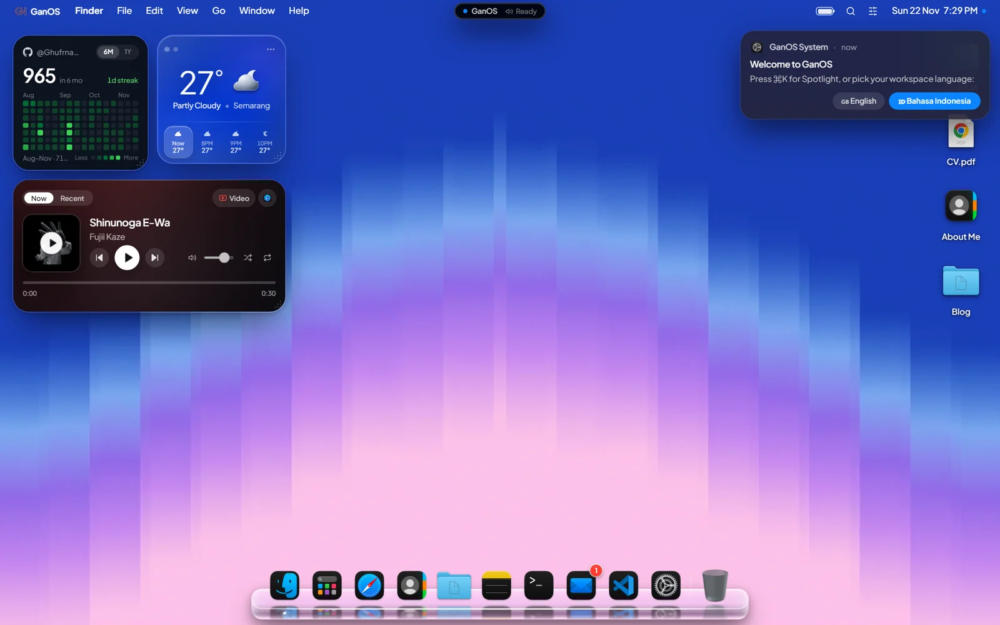
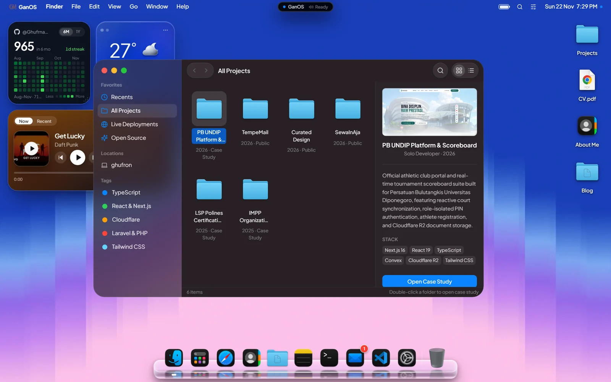
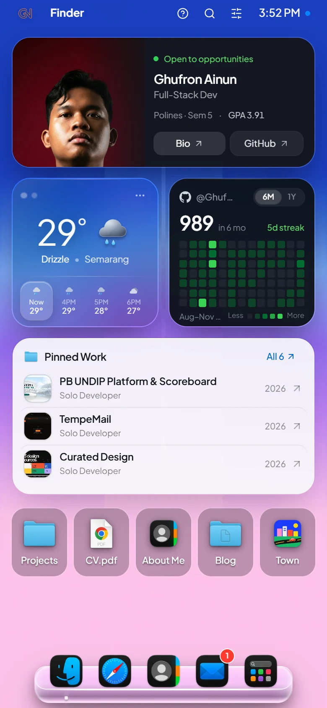

# Ghufron Ainun Najib — Desktop Portfolio

> Full-stack & mobile developer in Semarang, Indonesia. An interactive desktop portfolio experience built end to end.

**Live Website:** [ghufronainun.tech](https://ghufronainun.tech/)

[](https://ghufronainun.tech/)

---

## Overview

This repository powers **[ghufronainun.tech](https://ghufronainun.tech/)** — a macOS-inspired interactive web desktop housing the portfolio, engineering case studies, writing log, and resume of **Ghufron Ainun Najib**.

Designed with tactile liquid-glass surfaces, hardware-decoded animated wallpapers, spring-driven window management, and an adaptive iOS/iPadOS-style mobile home screen. The previous editorial portfolio remains preserved at `/old` and browseable directly inside the embedded Safari app.

---

## Previews

| Finder & Case Studies | Mobile OS Home Screen |
| :---: | :---: |
|  |  |

---

## Highlights

- **Interactive Desktop Shell (`v2.4`)**: Draggable/resizable windows with edge snapping, 3D glass dock with magnification physics, Menu Bar, Control Center, Dynamic Island, `⌘K` Spotlight search, `⌘Tab` app switcher, and Notification Center.
- **Built-in Apps**: Finder (Projects & Case Studies), curated sandboxed Safari (`/old`, portfolio routes, & YouTube embeds), Notes (with interactive skills checklist & scratchpad), interactive `zsh` Terminal (`help`, `neofetch`, `open`, `notify`), Mail, and System Settings (appearance, system font switcher, display brightness, and 16 dynamic/still wallpapers).
- **Live Desktop Widgets**: GitHub contribution heatmap & 12-month velocity bar chart (`6M` / `1Y`), live Semarang weather widget with adaptive glass refraction, interactive Music player, Quick Memo, and responsive Mobile Home Screen widget stack.
- **Hardware-Decoded Wallpapers**: 16 curated wallpapers (9 seamless H.264 MP4 loops with instant WebP posters + 7 high-res stills) with automatic `prefers-reduced-motion` and tab-visibility throttling.
- **Prerendered SEO & Structured Data**: Static HTML prerendering across all 11 public routes, dynamic Open Graph & Twitter Cards (`public/og-image.png`), JSON-LD schemas (`Person`, `ProfilePage`, `WebSite`, `SoftwareApplication`), `sitemap.xml`, `robots.txt`, and `llms.txt`.
- **Supabase Writing Log**: Type-safe blog queries, Tiptap rich-text editor, and Row-Level Security (RLS) for `/blog` and `/admin`.

---

## Featured Projects

### [PB UNDIP Platform & Scoreboard](https://pbundip.web.id/)
*Solo Developer · 2026*
- Official athletic club portal and real-time tournament scoreboard suite for Persatuan Bulutangkis Universitas Diponegoro.
- Reactive court scoring engine on Convex with multi-role PIN auth, Cloudflare R2 document uploads, and broadcast videotron displays.
- **Stack**: Next.js 16, React 19, TypeScript, Convex, Cloudflare R2, Tailwind CSS, Framer Motion.

### [TempeMail](https://github.com/Ghufrnainun/tempe-mail)
*Solo Developer · 2026 · [Live Demo](https://temp.ghufronainun.tech)*
- Disposable email service running entirely on Cloudflare Workers with multi-domain auto-provisioning across 20+ live domains.
- Features a REST API, HMAC-signed webhook delivery, D1 SQLite storage, and an MCP server for AI agents.
- **Stack**: TypeScript, Cloudflare Workers, D1, Hono.

### [Curated Design](https://github.com/Ghufrnainun/curated-design)
*Solo Developer · 2026 · [Live Demo](https://design.ghuf.app)*
- Searchable directory of curated design resources for AI coding — component libraries, design systems, inspiration, dev tools, and prompts.
- Markdown-first build pipeline with CI deployment to Cloudflare Pages and open GitHub contributions.
- **Stack**: React, Vite, Markdown, Cloudflare Pages, GitHub Actions.

### [SewaInAja](https://github.com/sewainaja-pbl)
*Full-Stack Developer (4-person team) · 2026*
- Rental platform spanning a customer-facing Flutter mobile app and a Next.js 16 administration & API surface with Firebase and Midtrans payments.
- **Stack**: Flutter, Next.js 16, TypeScript 5, Firebase, Midtrans.

### LSP Polines Certification Platform
*Team Lead (5-person team) · 2025*
- Certification management portal for Politeknik Negeri Semarang, owning team coordination, authentication architecture, and Git workflow.
- **Stack**: Laravel, Livewire, Tailwind CSS, MySQL.

### IMPP Organization Website
*Solo Developer · 2025*
- Public website and custom CMS for Ikatan Mahasiswa Pemalang Polines covering organizational structure, activities, and gallery publishing.
- **Stack**: Laravel, MySQL, Tailwind CSS.

---

## Tech Stack

| Layer | Technologies |
|---|---|
| **Frontend** | React 18, TypeScript 5, Vite 5 (SWC), React Router 6 |
| **Styling & UI** | Tailwind CSS 3, Radix UI Primitives, Lucide Icons |
| **Motion** | Framer Motion 12, GSAP, Lenis Scroll |
| **Data & State** | Supabase JS (`@supabase/supabase-js`), TanStack Query 5 |
| **Rich Text** | Tiptap Editor (`@tiptap/react`) |
| **Build & Assets** | Sharp, Static HTML Prerenderer, Sitemap Generator |

---

## Project Structure

```text
.
├── docs/screenshots/          # README desktop, Finder & mobile previews
├── public/                    # Static assets, wallpapers, audio, icons & metadata
│   ├── wallpapers/            # Curated H.264 MP4 loops, WebP posters & thumbnails
│   ├── macos-icons/           # App & desktop icon assets
│   ├── og-image.png           # Open Graph / Twitter share card (1200x630)
│   ├── _headers               # Edge cache & security headers
│   ├── _redirects             # Canonical & SPA routing fallbacks
│   ├── robots.txt             # Search & AI crawler rules
│   ├── sitemap.xml            # Build-generated XML sitemap
│   └── llms.txt               # Structured LLM profile index
├── scripts/                   # Sitemap, brand assets, prerender & verification scripts
├── src/
│   ├── components/
│   │   ├── os/                # Desktop shell, apps, widgets, Dynamic Island & WallpaperStage
│   │   └── ui/                # Reusable UI & 3D glass dock primitives
│   ├── data/                  # Static content (featuredProjects, sideProjects, profile, tracks)
│   ├── hooks/                 # Custom hooks (SEO metadata, auth, analytics)
│   ├── integrations/supabase/ # Supabase client & typed schema
│   ├── lib/                   # Dock physics, weather, audio & notification utilities
│   └── pages/                 # Route-level views (Index, Projects, About, Blog, Resume, OldHome)
└── supabase/                  # Database migrations & storage policies
```

---

## Local Development

### Prerequisites

- **Node.js**: `18.x` or higher (verified on Node 20 and Node 24)
- **Package Manager**: `npm`

### Setup

1. **Clone & install:**
   ```bash
   git clone https://github.com/Ghufrnainun/My-Porto-Guwe.git
   cd My-Porto-Guwe
   npm install
   ```

2. **Configure environment variables (optional for local dev; required for Supabase blog/admin):**
   Create a `.env` file in the root directory:
   ```env
   VITE_SUPABASE_URL=https://your-project.supabase.co
   VITE_SUPABASE_PUBLISHABLE_KEY=your-publishable-key
   ```

3. **Start the dev server:**
   ```bash
   npm run dev
   ```
   Open [http://localhost:8080](http://localhost:8080).

### Available Scripts

| Command | Action |
|---|---|
| `npm run dev` | Starts Vite dev server with HMR |
| `npm run build` | Generates sitemap, runs `tsc -p tsconfig.app.json --noEmit`, compiles `dist/`, and prerenders 11 static pages |
| `npm run preview` | Serves the production build locally |
| `npm run lint` | Runs ESLint across all `.ts`/`.tsx` files (zero warnings) |
| `npm run test:portfolio` | Validates featured & side project metadata |
| `npm run test:profile` | Validates profile, experience & certification data |
| `npm run test:ux` | Validates route navigation matching |
| `npm run test:widget-layout` | Validates desktop icon & widget layout geometry |

---

## Deployment

The project compiles to static assets in `dist/` with prerendered HTML snapshots, edge headers (`public/_headers`), and SPA fallbacks (`public/_redirects`) ready for Cloudflare Pages, Netlify, or Vercel:

```bash
npm run build
```

---

## Credits

This desktop portfolio started from [macOS Portfolio](https://github.com/R0shish/macos-styled-portfolio) by Roshish Shrestha ([macos.rosh.sh](https://macos.rosh.sh/)), a template made to be cloned and made your own. From there it was rebuilt on Vite + React and extended with the 3D town, desktop widgets, video wallpapers, the mobile home screen, prerendered SEO and the Supabase writing log.

---

## License

This project is licensed under the [MIT License](LICENSE).

---

© 2026 [Ghufron Ainun Najib](https://github.com/Ghufrnainun). All rights reserved.
